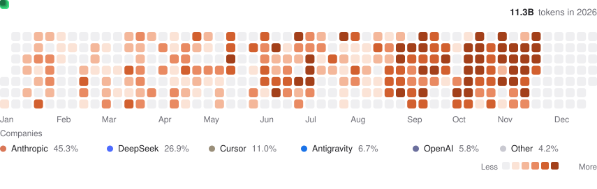

## Token Usage

<picture>
  <source media="(prefers-color-scheme: dark)" srcset="https://raw.githubusercontent.com/wqlttt/wqlttt/main/assets/token-usage-2026-dark.svg?v=2968f3e72169">
  
</picture>

<picture>
  <source media="(prefers-color-scheme: dark)" srcset="https://raw.githubusercontent.com/wqlttt/wqlttt/main/assets/token-usage-2025-dark.svg?v=7482ec7236ce">
  
</picture>

## 🐍 My GitHub Contribution Snake

<picture>
  <source media="(prefers-color-scheme: dark)" srcset="https://raw.githubusercontent.com/wqlttt/wqlttt/output/github-contribution-grid-snake-dark.svg?v=1">
  <source media="(prefers-color-scheme: light)" srcset="https://raw.githubusercontent.com/wqlttt/wqlttt/output/github-contribution-grid-snake.svg?v=1">
  
</picture>
